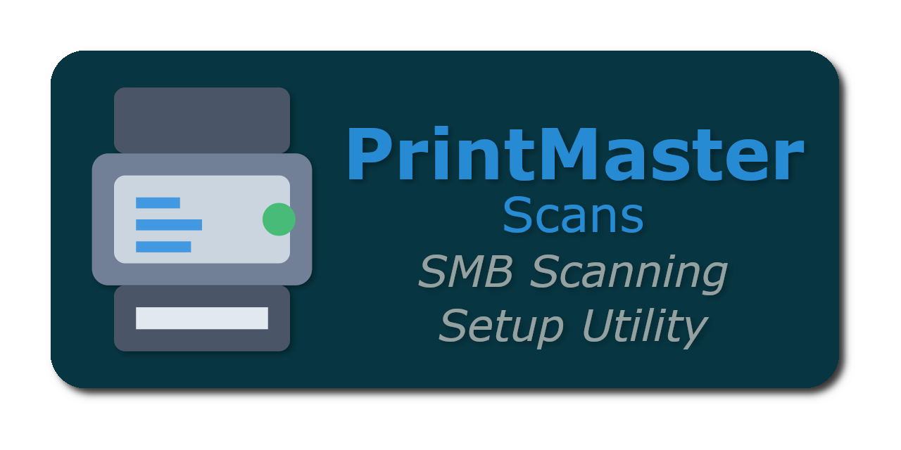
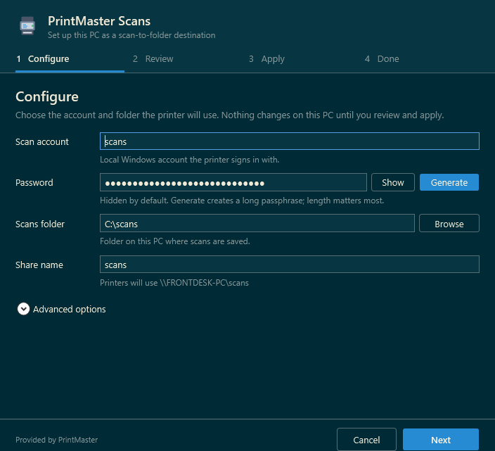
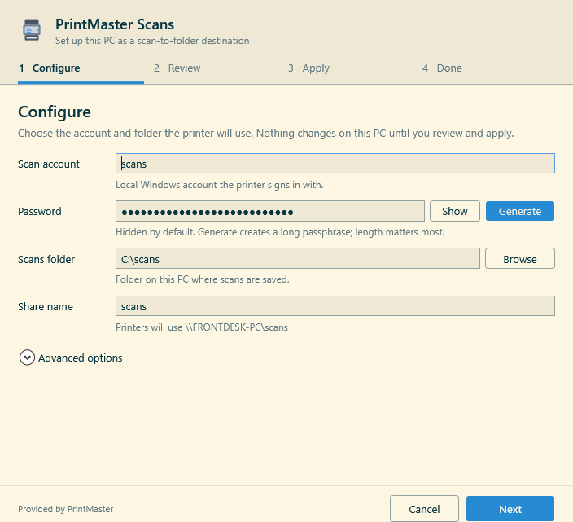
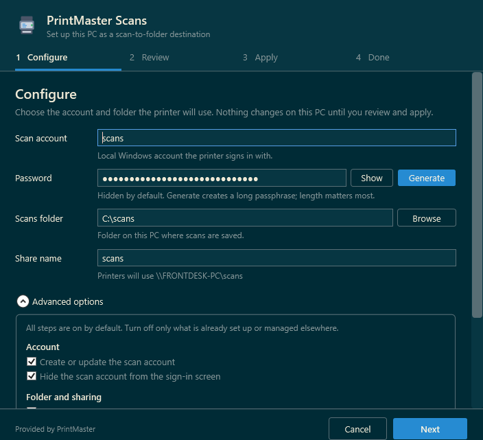
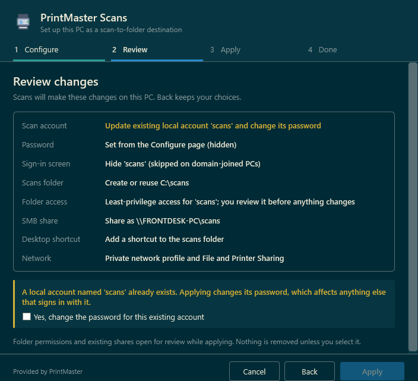
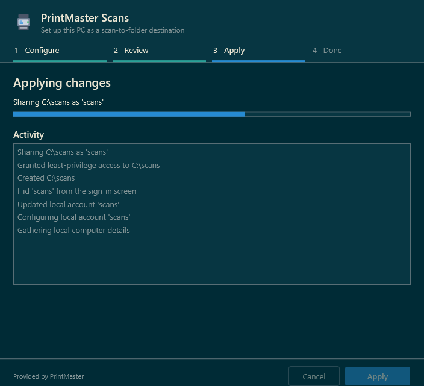
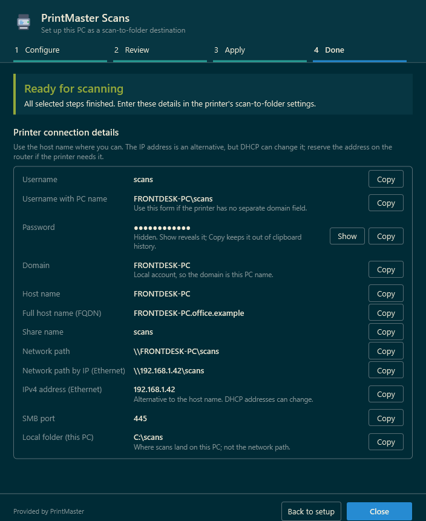
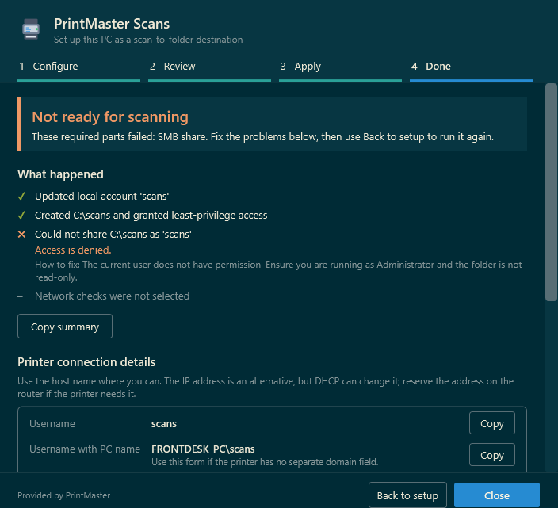
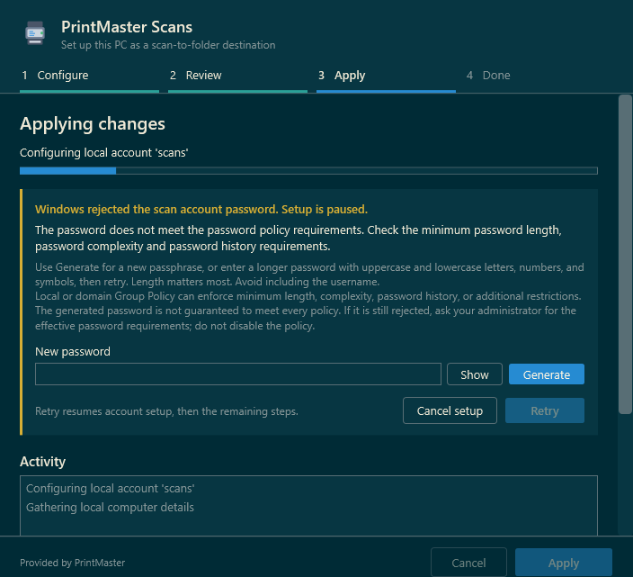

<div align="center">
  

[](https://github.com/Printmaster-Org/scans/releases/latest)
[](https://github.com/Printmaster-Org/scans/actions/workflows/ci.yml)
[](https://github.com/Printmaster-Org/scans/releases)
[](https://docs.printmaster.work/guides/scans/)


</div>

A lightweight PowerShell utility that configures a Windows PC for network scanning in one click. Creates a dedicated scan user, shared folder, firewall rules, and desktop shortcut — no manual setup required.

Provided by [PrintMaster](https://printmaster.work/). This is a standalone utility; no PrintMaster Agent or Server is required.

**[Get started](https://scans.printmaster.work/)** · **[Setup and troubleshooting guide](https://docs.printmaster.work/guides/scans/)**

## Quick Start

Paste the following into an **Administrator** PowerShell window:

```powershell
irm https://scans.printmaster.work/scans.ps1 | iex
```

### Stable releases and existing commands

The utility is maintained at **printmaster-org/scans**. The root script and the website use one shared loader implementation. The organization raw URL is also supported:

```powershell
irm https://raw.githubusercontent.com/printmaster-org/scans/main/scans.ps1 | iex
```

The new loader selects the promoted stable release from the site's manifest, downloads its version-specific GitHub asset, checks SHA-256, and only then executes it. From a normal (non-administrator) PowerShell window it then requests administrator approval through UAC; from an elevated window it runs directly. The approved process re-hashes the same bytes it executes, so a temporary file swapped after verification is refused. Declining UAC cancels without changes, and the loader waits for setup to finish before deleting the temporary file. Pinned older versions are launched the same way. A version can be selected explicitly:

```powershell
& ([scriptblock]::Create((irm https://scans.printmaster.work/scans.ps1))) -Version 'v2.1.0'
```

Pinned commands still require the loader and manifest to be available online. The old `mstrhakr/scans` raw URL relies on GitHub's repository-transfer redirect and now also runs the loader, not development utility code. If the site or manifest is unavailable, setup stops rather than falling back to `main`.

See the [transfer and release guide](docs/DEPLOYMENT.md) for rollout order, DNS, publishing, and cutover verification.

## Requirements

| Requirement | Details |
| --- | --- |
| **OS** | Windows 11 primary; Windows 10 22H2 best-effort compatibility |
| **PowerShell** | Windows PowerShell 5.1 or PowerShell 7 |
| **Privileges** | Administrator approval (UAC prompt) or an elevated PowerShell window |
| **Network** | Internet access to the release site and GitHub for the loader |

Windows 7/8/8.1 and Windows Server are not validated support targets. Windows 10 compatibility is not a claim of continued Microsoft support. Legacy command fallbacks remain for now; removing them is a separate change.

## What It Does

This script completely sets up the user environment for quick scan-to-SMB:

- Creates a dedicated scan user account or, after confirmation, updates an existing non-administrator account (hidden from login screen)
- Creates the scan folder at **C:\scans** (configurable)
- Sets restricted advanced folder permissions for the scan account, with Full Control for the receiving Windows user, local Administrators, and SYSTEM
- Shares the folder via SMB as **scans** (configurable)
- Creates a desktop shortcut to the scan folder
- Sets the network category to Private (non-domain PCs)
- Enables File and Printer Sharing firewall rules (all that SMB scan-to-folder needs)
- Optionally enables Network Discovery firewall rules. This is off by default because it's only useful for printers that browse the network for the PC instead of using a typed `\\PC\share` path. Scans never disables a Network Discovery rule that is already on. Versions up to v2.2.0 always enabled it.

Every step can be turned off under **Advanced options** before anything runs.

## Usage

Since v3.0.0, Scans is a four-page wizard: **Configure → Review → Apply → Done**. Nothing changes on the PC until you click **Apply** on the Review page. Screenshots use the example PC `FRONTDESK-PC` and simulated progress and results rendered from the current app UI; they do not show a real machine setup.

### 1. Configure

The account defaults to `scans`, the folder to `C:\scans`, and the share name to `scans`. v3.0.1 restores these defaults and the default step selections when launched through the release loader; v3.0.0 incorrectly left them empty or off.

Choose the scan account, password, scans folder, and share name. The password is a generated passphrase, hidden by default; **Show** reveals it and **Generate** creates a new one. The share name shows the network path printers will use.



The UI automatically matches your Windows theme (light or dark). App windows use the PrintMaster logo and attribution; the scan-folder desktop shortcut keeps its original scan icon. The logo is embedded as WPF vector artwork matching [site/logo.svg](site/logo.svg), so branding needs no extra download.



**Advanced options** (collapsed by default) turns individual steps on or off: create or update the account, hide it from the sign-in screen, create the folder, set folder permissions, share the folder, add a desktop shortcut, check network settings, and the optional Network Discovery rules. Options that depend on a disabled step are disabled with it: folder permissions require creating the folder, and Network Discovery requires the network checks.



**Cancel** or closing the window on Configure or Review exits without changes.

### 2. Review

Review lists every change Scans will make. If a field is missing or invalid, **Next** stays on Configure and lists the problems. **Back** keeps all your choices.



### 3. Apply

Apply shows live progress and an activity list. The window cannot be closed while a step is running. Folder access and existing-share reviews open as separate dialogs during this step (see below).



### 4. Done

Done reports one of four outcomes:

| Outcome | Meaning |
| --- | --- |
| **Ready for scanning** | Every selected step finished. |
| **Ready, with optional problems** | Only optional steps (desktop shortcut, Network Discovery) failed. |
| **Not ready for scanning** | A required step failed. The failed steps are listed first, with the error and how to fix it. |
| **Setup canceled** | Setup stopped before finishing; connection details are hidden. |

**Printer connection details** lists everything a printer's scan-to-folder settings may ask for: username (bare and `PC\user`), password, domain, host name, full host name (FQDN), share name, network paths by name and IP address, IPv4 addresses, SMB port 445, and the local folder. Each value has a **Copy** button. Prefer the host name; DHCP can change IP addresses, so reserve the address on the router if a printer needs it. The password row can be copied only if the password was set during this run.



**What happened** lists each step with its result, and **Copy summary** copies a plain-text report without the password. **Back to setup** returns to Configure with your choices kept, so you can fix a problem and run again.



### Existing account safety

If the scan account already exists, Review warns that applying will change its password, which affects anything else that signs in with it. **Apply** stays disabled until you tick **Yes, change the password for this existing account**. If the account appears between Review and Apply, a confirmation dialog asks again; declining stops setup without changing the account. Accounts in the local Administrators group are never changed; choose another username or cancel setup. If Scans cannot verify group membership, it also refuses to change the account.

### Password handling

Since v3.0.0, passwords are handled as follows ([issue #29](https://github.com/Printmaster-Org/scans/issues/29)):

- Password fields are masked by default. **Show** reveals the text until you hide it again.
- The password stays in a .NET `SecureString` from the password box to the Windows account cmdlets. Plaintext is created only briefly for the legacy `net user` fallback on systems without the LocalAccounts module, and for Copy and Show.
- Error messages and logs never include the password; text Windows echoes back is redacted.
- **Copy** marks the clipboard entry so Windows clipboard history and cloud clipboard sync skip it. When the window closes, Scans clears the clipboard only if it still holds the copied password.

These are exposure reductions, not guarantees. `SecureString` limits casual exposure in memory dumps and logs; it is not encryption at rest. PowerShell cannot zero every intermediate string. The legacy `net user` fallback must pass the password as a command-line argument, so it is briefly visible to other administrators' process listings. Clipboard managers that ignore the Windows exclusion formats can still capture a copied password, and screen recording can capture a revealed one.

### Themed dialogs

Scans uses a shared Solarized light/dark dialog shell for folder access, existing-share reviews, share name conflicts, the late existing-account confirmation, and startup errors. Dialogs carry the PrintMaster logo and attribution, center on the wizard, and keep longer content scrollable with the action buttons visible.

Shared dialog footers place an outlined, neutral **Cancel** to the left of the filled, emphasized approval action at the far right. Confirmations focus Cancel first; closing the window or pressing Escape is not consent. Folder/share permission confirmations do not default Enter to approval. Their permission tables keep themed, readable full-row hover and selection states, including when keyboard focus moves elsewhere; a border distinguishes selection and keyboard focus.
### Folder access review

Available since v2.2.0. Earlier releases granted the scan account Full Control and added Everyone Modify (plus Domain Users Modify on domain-joined PCs) without review.

When **Set folder permissions** is selected, a separate review asks which Windows user should receive scans. It defaults to the user of the desktop session hosting Scans, including an RDP session, not the elevated administrator token. If these identities differ, the dialog explains that **Apply permissions** confirms the receiving user. You can edit the recipient; if no desktop user is detected, you must enter one. The recipient cannot be the scan account.

For a **new folder**, inheritance is disabled and the following Allow rules apply to the folder, subfolders, and files:

| Principal | NTFS rights |
| --- | --- |
| Local scan account | List folder / read data; Create files / write data; Create folders / append data |
| Receiving Windows user | Full Control |
| Local Administrators and SYSTEM | Full Control |

Windows adds `Synchronize` to the scan account's Allow rule. The scan profile does not explicitly grant delete, execute, permission changes, or ownership. Read data can expose existing scans, and write data can allow overwriting them; this is not a write-only drop box or a universal printer-compatibility guarantee.

Neither Everyone nor Domain Users is added by default. **Also grant Everyone Modify** is an explicit, unchecked option for broader NTFS access; it allows other users to read, change, and delete scans. SMB share permissions are separate.

For an **existing folder**, review the displayed ACL. Scans preserves inheritance, custom rules, and protected child ACLs. Explicit Everyone/Domain Users Modify rules and scan-account Full Control rules matching the old utility's exact shape appear as individually selectable cleanup candidates, all unchecked. Old versions did not record rule ownership, so no matching rule is assumed to belong to Scans. Only entries you select are removed; inherited and unrelated entries remain. Retained grants or group memberships can give the scan account more effective access than the new profile. Review **Effective Access** in Windows rather than treating the folder as hardened.

The review separates the recipient, scan-account rights, and folder policy into sections. Existing permissions appear in a table with resolved Windows account names, Allow/Deny indicators, access, explicit/inherited source, and scope. Hover over a row for the SID and exact rights. Deleted or unavailable identities are labeled **Unresolved account** and logged rather than given an invented name. Only eligible cleanup rows offer a **Remove** checkbox. Amber notices highlight permission risks and alternate-admin identities; the optional Everyone grant is under **Advanced**, with an additional warning while selected. This is a presentation of individual ACL entries, not an effective-access calculation.

Canceling the review or failing folder setup skips SMB share configuration and reports an error; independent selected steps can still run. Cancellation happens before creating the folder or writing its ACL, but earlier account changes are not rolled back. If folder creation succeeds and the ACL write fails, the error warns that the folder retains inherited permissions.

Test a real scan before relying on the destination. Some printers require additional attributes, rename, or delete access; do not broaden permissions silently to make a test pass.

### Existing SMB shares

Since v2.2.0, Scans checks the selected local folder and any existing share's path before changing share permissions. A conflicting name opens **Share name conflict**: choose another share name to check or cancel share setup. Scans never repoints, deletes, or recreates the conflicting share. Use the share name shown on the Done page for printer configuration.

New shares grant **Change**, not Full, to the explicitly qualified local scan account. This is the SMB permission layer; the folder's NTFS ACL still limits actual file operations. No Everyone share grant is added.

For an existing share pointing to the selected folder, **Review SMB share access** shows resolved account names, Allow/Deny entries, and Read/Change/Full rights. The warning counts other-account grants, scan-account Full grants, and Deny entries. Existing access is preserved unless you explicitly select individual **Remove** checkboxes, all unchecked initially. Deny entries are never removed. When several Allow entries resolve to the same principal, removal is unavailable because Windows' revoke command would remove all of them. Review such ACLs in Windows.

**Apply share access** adds Change only if the scan account does not already have Change or Full. Existing scan Full is retained unless you select its removal; selecting it replaces Full with Change. Other selected Allow grants are removed without resetting the share ACL. Preserved group grants can still give broader access, and Deny entries can still block scanning; this is not an effective-access calculation.

Cancel, Escape, or closing a review makes no share changes. Scans rechecks the share path, scope, and ACL after review and stops if they changed. This is a best-effort concurrency check, not an atomic lock against other administrators. Special/scoped or unreadable shares are refused rather than guessed. If a later write fails, the Done page reports successful partial changes; no automatic rollback is attempted. Earlier account/folder work is not rolled back, and independent selected steps can continue.

Without SMB cmdlets, Scans uses structured WMI lookup and a create-only WMI operation with an explicit Change ACL for new shares. It refuses to edit existing shares in this mode; configure them in Windows or rerun with SMB cmdlets. Lookup failures are errors, never evidence that a share is absent. Validate both normal and legacy paths on a disposable VM and test real printer delivery before release.

### Password policy errors

Windows can reject a scan-account password that does not meet the effective local or domain Group Policy requirements, even for a local account. A short, lowercase-only password may fail minimum-length or complexity rules.

If Windows reports `InvalidPassword` (or `net user` system error `2245` on older systems), setup pauses and the Apply page shows the error with a **New password** field. Enter a replacement or click **Generate**, then **Retry**. Account setup is retried before hiding the account, setting folder permissions, configuring the SMB share, or running any other remaining steps. Your other setup choices are preserved. If Windows rejects another password, you can edit or generate one and retry again.


Choosing **Cancel setup** stops the remaining setup steps and the Done page reports **Setup canceled**. After a successful retry, setup continues normally; the accepted password is written back to the Configure page and is the one shown on the Done page.

Use the generated passphrase or a long password of your own, without the username. Generated passphrases are not guaranteed to satisfy every policy. If the password is still rejected, ask your administrator for the effective minimum length, complexity, history, and any additional restrictions rather than disabling the policy.

### Generated passphrases

The setup window and **Generate** create a passphrase such as `Brook-Ocean7-Gnat-Plaza-Rumor`: five capitalized words joined by hyphens, with one random digit after one random word. Current guidance (for example NIST SP 800-63B) treats length as the main source of password strength, so a passphrase is stronger and easier to type on a printer panel than a short random string. Each passphrase is 20–30 characters with about 57 bits of entropy. That stays within the 32-character password limit common on printers, and the mix of upper, lower, digit, and symbol still satisfies the Windows complexity policy.

Words come from the [EFF Short Wordlist 1](https://www.eff.org/dice) (CC BY 3.0 US), embedded in the utility so releases remain a single hash-verified script. `yo-yo`, `scan`, and `user` are removed so hyphens only separate words and passphrases don't resemble the account name. Selection uses a cryptographic random generator with rejection sampling, so every word is equally likely. Logs record the word count and estimated strength, never the passphrase. On older systems that fall back to `net user`, setup automatically answers its "longer than 14 characters" confirmation prompt.

### Other setup errors

Startup failures stop setup with an error dialog. Failed setup steps no longer interrupt with popups: setup continues with independent steps, and the Done page lists each failure with the original error and how to fix it. Domain trust failures, access denied, and shares in use have specific guidance; unexpected errors keep their original details with general troubleshooting guidance. Steps that depend on a failed step (for example the share after a failed folder) are skipped and listed.

## Development and deployment

Both public entrypoints select manually published, versioned GitHub Releases. Merging utility code does not deploy it to users. Merging loader changes does update the raw-main loader; website loader changes require a Pages refresh.

Pushing a stable SemVer tag starts the [Prepare release workflow](.github/workflows/release.yml). It reuses successful main-push CI for that exact commit instead of running tests again, then creates a draft with generated PR-based notes, a pinned command, the utility, metadata, and SHA-256. It waits briefly if main CI is still running and fails if that CI did not pass. Manual dispatch from `main` can retry an existing tag and packages that tag's source, not newer main code. Review/edit the notes, manually test on a disposable Windows VM, then publish the draft in GitHub. User publication triggers the [Pages workflow](.github/workflows/pages.yml), which also reuses existing CI, verifies published assets against their tagged source, and deploys the site plus manifest as generated artifacts. No bot pushes or protection bypasses are needed.

Website source is in [site/](site/); the only loader source is [scans.ps1](scans.ps1). The site builder copies it unchanged into its deployment output. The actual utility is [src/scans.ps1](src/scans.ps1); release packaging selects that file, never the loader. New stable tags must use `vMAJOR.MINOR.PATCH`; historical four-part tags are retained and linked through GitHub Releases, but not exposed through the new checksum-verified channel.

The landing page follows the PrintMaster site's Solarized palette, teal accents, wordmark, and panel styling. Standalone navigation is Scans-focused: its brand links home locally, setup and release links stay on the page, and external Scans resources are explicitly labeled. The footer separates Agent/Server downloads and fleet-monitoring links under "More from PrintMaster." Styles and the logo are local to this repository; navigation works without JavaScript, and the layout supports light/dark preferences, keyboard navigation, and reduced motion. Release rendering and copy buttons use [site/releases.js](site/releases.js).

The landing page loads GoatCounter asynchronously using `https://printmaster-scans.goatcounter.com/count`, matching the analytics integration on the main and documentation sites. This website-only integration does not change the PowerShell loader or utility.

The main website can frame `https://scans.printmaster.work/?embed=1` at `/scans/`. [site/embed.js](site/embed.js) hides this site's header/footer and locks the dark palette only after a handshake from the immediate parent at `https://printmaster.work`. Without that handshake (including direct visits and JavaScript disabled), the full standalone site remains visible. Origin- and source-checked messages report content height and anchor positions to the main site's wrapper. External links open at the top level; setup commands retain their canonical standalone URLs. The main site owns its header/footer and clipboard delegation. Deploy this embed support before the main-site wrapper.

The handshake restricts embed-mode activation, not who can frame the public standalone site. GitHub Pages cannot set a custom HTTP `Content-Security-Policy: frame-ancestors` header; a meta tag cannot enforce it. If the domain later uses a configurable edge/server, set `frame-ancestors 'self' https://printmaster.work` there and avoid `X-Frame-Options: DENY`/`SAMEORIGIN`, which would block the cross-origin main-site frame.

Direct, fast-forward pushes to `main` are permitted; feature branches and pull requests are optional. Run the relevant local tests before pushing. The [CI workflow](.github/workflows/ci.yml) runs syntax checks and mocked Pester tests on Windows using both Windows PowerShell 5.1 and PowerShell 7. Its **Required checks** job passes only when both test jobs succeed, including when using a merge queue. CI also runs after pushes to `main` and can be started manually.

External actions are pinned to full commit SHAs. [Dependabot](.github/dependabot.yml) checks GitHub Actions dependencies weekly and opens update PRs.

`main` does not require pull requests or pre-merge status checks; a repository ruleset only blocks force-pushes and branch deletion. Secret scanning push protection rejects pushes containing detected credentials. Post-push CI detects failures but does not prevent a push or merge. Release preparation and Pages promotion still require successful main-push CI for the selected source commits. Utility changes reach users only through a manually published release; the raw-main loader itself still changes immediately when pushed.

### Running tests locally

Install the pinned development dependency once (it is not needed by users running the utility):

```powershell
Install-Module Pester -RequiredVersion 4.10.1 -Scope CurrentUser -Force -SkipPublisherCheck
```

From the repository root, run either runtime:

```powershell
powershell.exe -NoProfile -STA -File .\tests\Invoke-Tests.ps1
pwsh.exe -NoProfile -STA -File .\tests\Invoke-Tests.ps1
node --test .\tests\site.test.cjs .\tests\embed.test.cjs
```

The [test runner](tests/Invoke-Tests.ps1) fails on syntax errors, failing tests, or an empty test run. The [regression suite](tests/Scans.Tests.ps1) extracts function definitions without running the utility's elevation or setup code. Account, registry, filesystem, SMB, firewall, clipboard-related setup gating, and COM changes are mocked; WPF windows are loaded and selected binding tests render off-screen. Legacy share tests construct real in-memory CIM security descriptors but mock the machine-changing calls. Tests cover the wizard pages and navigation, the review gate, Done-page outcomes and connection details, SecureString and clipboard handling, password failures and retry, account visibility, folder setup, share conflicts/reviews/partial failures, network configuration, shortcuts, generated passphrase format and unbiased word selection, and setup options. The generator tests do not claim that every generated passphrase satisfies policy.

The [release tests](tests/Releases.Tests.ps1) cover loader selection, verification failures, temporary-file cleanup, package integrity, and site generation. Site rendering tests use Node's built-in test runner with no additional dependencies.

These checks do not replace a manual test of the real GUI and machine configuration on a disposable Windows VM. CI uses a current Windows runner; Windows 10 compatibility and legacy command paths are not exercised on an actual Windows 10 runner.

## Features

- **Solarized theming** — auto-detects Windows light/dark mode, defaults to dark
- **Platform support** — Windows 11 primary; Windows 10 22H2 best-effort compatibility
- **Guided wizard** — Configure, Review, Apply, Done; nothing changes until you apply, and Done lists every printer connection detail with Copy buttons
- **Error remediation** — failed steps listed on the Done page with tips for common failures (password policy, trust relationship, access denied, share in use), plus dependent-step safeguards
- **Portable utility** — no application installation; release loader verifies downloads before execution
